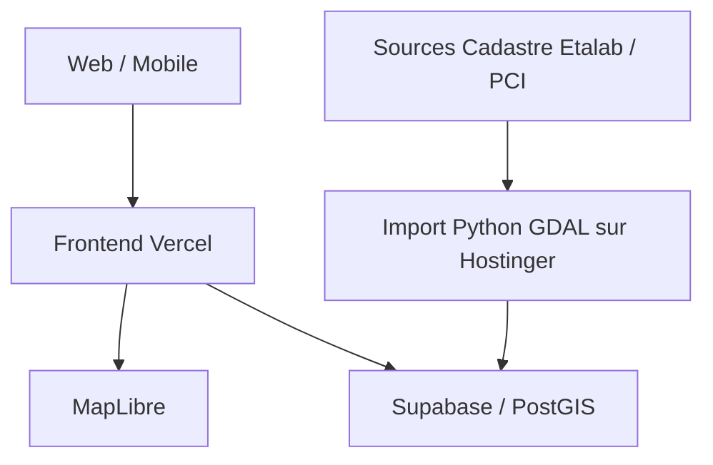

# Architecture

## Cible
- **Frontend** : React, Vite, TypeScript, MapLibre GL JS, affichage responsive.
- **Hébergement** : Vercel, domaine `cadastre.jaume-eric.com` géré chez Hostinger.
- **Persistance cible** : Supabase PostgreSQL/PostGIS ; authentification et règles RLS.
- **Imports** : traitement GDAL/Python isolé sur VPS Hostinger, import PostgreSQL/PostGIS.
- **Cartographie** : OSM initialement ; couches IGN et tuiles vectorielles à ajouter.

## Situation v0.1.0
La version initiale tourne sans backend. Les projets et les GeoJSON sont mémorisés en localStorage. Ne pas confondre cette étape avec l'architecture de production.
