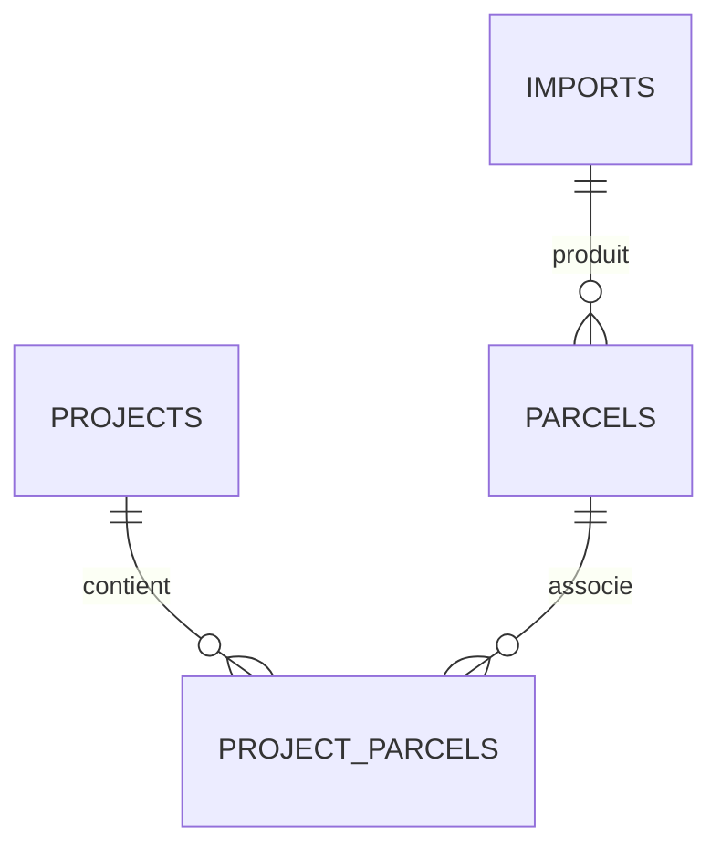

# Modèle de données

Tables prévues : `projects`, `parcels`, `project_parcels`, `imports`. Les parcelles sont référencées une seule fois, plusieurs projets peuvent pointer sur une même parcelle.

Géométrie stockée en PostGIS ; surface géométrique calculée séparément de la contenance cadastrale lorsqu'elle est disponible. Identification par ID cadastral avec conservation du millésime.
